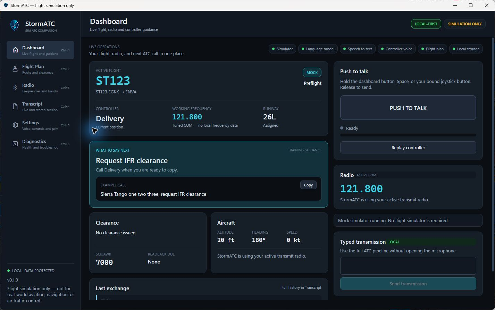

# StormATC

Un compagnon ATC gratuit, libre et piloté à la voix pour Microsoft Flight Simulator.

[](https://github.com/stormairfly/StormATC/actions/workflows/ci.yml)
[](https://github.com/stormairfly/StormATC/releases/latest)
[](LICENSE)
[](https://github.com/stormairfly/StormATC/labels/good%20first%20issue)

[Site du projet](https://stormairfly.github.io/StormATC/) ·
[Dernière version](https://github.com/stormairfly/StormATC/releases/latest) ·
[Contribuer](CONTRIBUTING.md) ·
[English](README.md)



**Envie de voler avec ?** [Téléchargez l'installeur Windows ou le ZIP portable](https://github.com/stormairfly/StormATC/releases/latest)
et lisez [Installation](#installation-windows).
**Envie de l'améliorer ?** Choisissez une [`good first issue`](https://github.com/stormairfly/StormATC/labels/good%20first%20issue)
ou lisez le [guide de démarrage du contributeur](docs/contributor-quickstart.md).

> **StormATC est un produit de divertissement pour la simulation de vol uniquement. Il ne doit
> pas être utilisé pour l'aviation réelle, la navigation, la préparation de vol ou le contrôle
> aérien réels.**

---

## Ce que c'est

StormATC donne un contrôleur à un vol simulé. Vous appuyez sur une touche, vous dites ce que dirait
un pilote, et un contrôleur répond : avec des clairances qui suivent la procédure, des collationnements
réellement vérifiés et des transferts qui arrivent quand ils doivent arriver.

Le logiciel est volontairement **modulaire** et **apporte votre propre clé d'API**. L'application est
gratuite ; les services de reconnaissance vocale et de langage, optionnels, sont des produits tiers que
vous reliez avec vos propres comptes.

## Ce que ce n'est pas

Ce n'est pas un outil pour le monde réel, ni un remplaçant de quoi que ce soit utilisé en aviation
réelle. Il n'est ni affilié, ni dérivé, ni compatible avec un module ATC commercial. Tout le code, les
prompts, les données et l'interface de ce dépôt sont originaux.

---

## Le principe de conception

Tout dans StormATC découle d'une règle :

> **Le simulateur détermine ce qui est physiquement vrai.
> Le moteur ATC déterministe détermine ce qui est permis.
> Le modèle de langage aide à comprendre le pilote et à exprimer naturellement les instructions approuvées.**

Un modèle de langage ne fait jamais autorité sur la position, l'altitude, le cap, la vitesse, la
configuration de l'avion, la fréquence, la disponibilité d'une piste, la séparation du trafic, les codes
transpondeur, les routes de roulage, les altitudes ou routes autorisées, les caps assignés, la
juridiction du contrôleur, la phase de vol, l'exactitude d'un collationnement, ni sur la disponibilité
d'une autorisation de décollage ou d'atterrissage. Tout cela vient du simulateur et de
`StormAtcStateEngine`, du C# ordinaire, testable et déterministe.

Là où un modèle *est* utilisé, sa sortie est traitée comme une entrée non fiable :

- Une **intention reconnue** est recalculée par les objets valeur du domaine. Une piste invalide, une
  fréquence hors bande, un code transpondeur contenant un 8 : dans tous ces cas, toute la réponse est
  écartée et le résultat de l'analyseur local s'applique.
- Les **phrases générées** sont comparées aux faits approuvés par le moteur. Chaque nombre du texte doit
  correspondre à une valeur approuvée. Une réponse fluide contenant une altitude que le moteur n'a jamais
  donnée est rejetée, et la formulation déterministe est prononcée à la place.

Voir [docs/architecture.md](docs/architecture.md).

---

## Fonctionnalités

- **À la voix d'abord** : push-to-talk en entrée, réponses du contrôleur parlées en sortie, avec une
  chaîne audio à effet radio
- **Radio en français et interface en français** : phraséologie de type DSNA, interface en français,
  et une reconnaissance qui comprend le pilote d'après l'étape du vol, pas seulement d'après des
  phrases exactes
- **Voix locale, sans compte** : [Whisper](https://github.com/ggml-org/whisper.cpp) vous reconnaît et
  [Piper](https://github.com/rhasspy/piper) fait parler le contrôleur, tous deux sur votre ordinateur,
  avec plusieurs voix de contrôleurs et un bouton « Je n'aime pas cette voix » qui retire une voix dont
  vous ne voulez pas (aussi dans le panneau MSFS, pour ne jamais avoir à quitter le simulateur)
- **Vols VFR sur aérodrome contrôlé** : circuit local, main gauche ou main droite, profils
  d'aérodrome, et un contrôleur qui reste avec la tour comme pour un vrai vol VFR
- **Push-to-talk matériel** : associez un bouton d'un joystick USB, d'un manche, d'une manette ou d'un HOTAS
- **Entraîneur vocal sensible à l'accent** : mots-clés personnels et corrections explicites sans
  conserver d'audio
- **Saisie de secours** : utilisez toute la chaîne ATC sans microphone ni compte cloud
- **Moteur ATC déterministe** : livraison des clairances, sol, tour, départ, centre, approche
- **Vrai contrôle des collationnements** : point par point, avec des corrections ciblées qui nomment la
  valeur erronée
- **Roulage MSFS en direct** : parkings, points de roulage, noms, chemins, pistes et fréquences viennent
  de l'API Facility Data du simulateur ; les routes partent de la position réelle de l'avion au sol et
  évitent les traversées de piste quand c'est possible
- **Entraînement au roulage de type VATSIM** : le tableau de bord montre le parking ou la voie de
  circulation actuelle, la limite de clairance, la route restante, le prochain virage et les panneaux
  attendus aux intersections, tout en gardant une phraséologie radio concise
- **ATIS de départ avant le premier contact** : COM1 démarre sur l'ATIS publiée et StormATC énonce
  l'aérodrome, le code d'information, l'heure Zulu, la météo observée, la piste et le QNH ; la page Radio
  montre les mêmes faits et rejoue en boucle un audio nommé en cache sans nouvelle synthèse. Des
  comparaisons déterministes locales ne créent une nouvelle édition que lorsque les valeurs
  opérationnelles changent ; aucun modèle de langage ne génère ni ne vérifie l'ATIS
- **Le plan de vol de l'EFB, en direct** : un petit module WASM dans MSFS lit le plan fait dans l'EFB et
  le transmet à StormATC dès que vous appuyez sur **Envoyer à l'ATC** (ou à l'avionique) : aérodromes,
  pistes, VFR ou IFR, route et, pour un plan IFR, la **SID, la STAR et l'approche** choisies. Un fichier
  `.PLN` peut aussi être chargé
- **Remise de gaz** : la remise de gaz de l'approche prévue est lue dans les données de navigation du
  simulateur et montrée sur la page Plan de vol
- **Panneau dans la barre d'outils de MSFS, utilisable en VR** : le dialogue ATC et la phraséologie de la
  phase de vol en cours (VFR ou IFR) dans un panneau à l'intérieur du simulateur
- **Un seul installeur pour tout** : StormATC, le panneau et le module dans le dossier Community de MSFS
  (Store ou Steam) et, si vous le cochez, Whisper, Piper et les voix, avec les réglages déjà faits
- **Cartes dans le panneau** : vos cartes PDF s'ouvrent dans le panneau MSFS, celle de la destination en premier,
  dans le cockpit ou en VR ; des profils VFR pour une liste d'aérodromes qui s'allonge (points de report, hauteur du
  circuit, piste préférée) sont lus sur les cartes AIP
- **Aide intégrée** : liens de téléchargement et guides PDF pour les logiciels tiers et les voix, depuis
  la page Réglages
- **Prise en compte du trafic FSLTL (optionnelle)** : lit le trafic en mouvement du simulateur par
  SimConnect, identifie les modèles FSLTL et montre les contacts proches sans contrôler ni dupliquer
  l'injecteur de trafic
- **Radio de trafic simulé (optionnelle)** : affiche de temps en temps des échanges ATC/pilote avec des
  formulations locales gratuites, ou, séparément, avec des formulations et une voix par IA avec un
  plafond d'usage horaire
- **MSFS par SimConnect**, connecté automatiquement quand le simulateur tourne, et basculé tout seul si
  vous le démarrez plus tard, avec un avion simulé par script en attendant
- **Import SimBrief depuis l'application** : saisissez votre identifiant une fois et StormATC récupère
  votre dernier plan. Rien à télécharger, rien à importer à la main
- **Historique local uniquement** : transcriptions et sessions vivent dans un fichier SQLite sur votre machine
- **Identifiants protégés** : les clés d'API sont chiffrées par DPAPI et ne peuvent être envoyées qu'aux
  points d'accès officiels des fournisseurs
- **Fonctionne sans rien configurer** : sans clé d'API, sans simulateur et sans réseau, on obtient quand
  même une session ATC complète et jouable avec des transmissions écrites et une phraséologie déterministe

---

## Prérequis

- Windows 10 ou 11
- Le [SDK .NET 10](https://dotnet.microsoft.com/download) pour compiler, ou le .NET 10 Desktop Runtime pour exécuter
- Optionnel : Microsoft Flight Simulator 2024 (le panneau de la barre d'outils et le module de l'EFB sont
  faits pour lui) et, pour compiler depuis les sources avec SimConnect, le SDK MSFS
- Optionnel : Whisper et Piper pour la voix locale : l'installeur peut les télécharger
- Optionnel : FSLTL pour le trafic injecté ; FlyByWire SimBridge n'est pas nécessaire
- Optionnel : un compte OpenRouter, OpenAI API, Groq, DeepSeek ou Anthropic pour l'interprétation des
  intentions et la phraséologie assistées par modèle
- Optionnel : un compte [Deepgram](https://deepgram.com) pour la reconnaissance vocale et la voix du contrôleur

---

## Installation (Windows)

1. Téléchargez `StormATC-Setup-vX.Y.Z-win-x64.exe` depuis la
   [dernière version](https://github.com/stormairfly/StormATC/releases/latest) (le ZIP portable n'a pas
   besoin d'installeur mais n'installe pas le panneau MSFS).
2. Lancez-le. Il ne demande pas de droits administrateur et propose, en options cochées :
   - **Installer le panneau et le module dans MSFS** (cochée si MSFS est trouvé) : le panneau de la
     barre d'outils et le module du plan de vol de l'EFB vont dans le dossier Community de MSFS, édition
     Store ou Steam ;
   - **Télécharger la reconnaissance vocale et les voix locales** : Whisper, Piper et les voix françaises
     et anglaises, avec StormATC réglé pour les utiliser.
3. Lancez StormATC, puis **redémarrez MSFS une fois** : un module se charge au démarrage du simulateur.

L'installeur n'est pas encore signé : Windows peut afficher un avertissement d'éditeur inconnu. Les
logiciels tiers et les voix ont leurs propres licences : voir
[docs/third-party-downloads.md](docs/third-party-downloads.md).

---

## Compiler et lancer

```bash
git clone https://github.com/stormairfly/StormATC.git
```

```bash
cd StormATC && dotnet restore --locked-mode
```

```bash
dotnet build StormATC.sln -c Release
```

```bash
dotnet test StormATC.sln
```

```bash
dotnet run --project src/StormATC.Desktop
```

Le premier lancement affiche un écran sur la portée, le coût et ce qui quitte votre ordinateur. Refuser
les services cloud optionnels est un choix pris en charge : l'application fonctionne pleinement sans eux.

### Raccourci développeur « toujours la dernière version »

Lancez ceci une fois depuis PowerShell :

```powershell
.\scripts\Create-StormATC-Shortcut.ps1
```

Il crée **StormATC (Latest)** sur le bureau Windows. Le raccourci ferme proprement la fenêtre StormATC de
ce dépôt, lance une compilation Release incrémentale, puis démarre le résultat. Les échecs de compilation
sont affichés avec les chemins des journaux du lanceur au lieu d'ouvrir un ancien exécutable.

La navigation au clavier est disponible partout : **Ctrl+1** à **Ctrl+6** ouvrent chaque page, et
**Ctrl+,** ouvre les Réglages.

---

## Ce qui se passe au premier lancement

Rien n'est à configurer. Chaque partie décide pour elle-même, et dit ce qu'elle a décidé :

| | Sans aucune configuration | Une fois configuré |
| --- | --- | --- |
| **Simulateur** | Un avion scripté vole la route fictive fournie STMR → STMD | MSFS est connecté automatiquement quand il tourne. Démarrez-le plus tard et StormATC bascule tout seul |
| **Plan de vol** | Le vol d'exemple fictif fourni | Appuyez sur **Envoyer à l'ATC** dans l'EFB de MSFS (le module installé avec StormATC transmet le plan), chargez un fichier `.PLN`, ou saisissez votre identifiant SimBrief sur la page Plan de vol |
| **Parole** | Utilisez la transmission écrite du tableau de bord | Installez Whisper et Piper (l'installeur sait le faire) pour une voix locale sans compte, ou ajoutez une clé Deepgram, puis maintenez le push-to-talk |
| **Formulation** | Phraséologie déterministe, toujours disponible | Choisissez OpenRouter, OpenAI, Groq, DeepSeek ou Anthropic et ajoutez la clé et le modèle de ce fournisseur |

Chacun de ces points est indépendant. Ajouter un identifiant SimBrief n'active aucun service cloud, et
connecter un simulateur ne demande aucune clé. Rien ne contacte rien tant que vous ne l'avez pas
configuré, et un **mode hors ligne** dans les Réglages le garantit quelle que soit la configuration.

---

## Coût

**StormATC est gratuit et libre.** Pas de compte, pas de télémétrie, pas d'abonnement.

**Chaque fournisseur cloud optionnel est un service tiers indépendant.** OpenRouter, OpenAI, Groq,
DeepSeek, Anthropic et Deepgram facturent leurs propres comptes d'API selon leurs tarifs en vigueur.
StormATC ne les revend pas et n'avance rien sur leurs prix. Un abonnement ChatGPT n'inclut pas l'usage
de l'API OpenAI.

### Fournisseurs

StormATC v0.2 prend directement en charge OpenRouter, OpenAI, Groq, DeepSeek et Anthropic pour les
modèles de langage, et Deepgram pour la parole dans le cloud. La reconnaissance et les voix locales
(Whisper et Piper) fonctionnent sans aucun compte. Les abstractions de fournisseurs restent ouvertes à
d'autres services cloud de reconnaissance et de synthèse vocales.

Toute intégration cloud reste optionnelle. Les utilisateurs et contributeurs apportent leurs comptes et
clés d'API ; StormATC n'en émet, n'en embarque ni n'en partage.

---

## Clés d'API

Les clés sont conservées par le système d'exploitation sous votre compte utilisateur, via DPAPI.
StormATC :

- n'écrit jamais une clé dans `appsettings.json` ni dans aucun autre fichier de réglages
- ne stocke jamais une clé dans la base SQLite
- n'écrit jamais une clé dans un journal
- n'inclut jamais une clé dans un message d'exception ni dans un export de diagnostic
- ne vous réaffiche jamais une clé enregistrée
- n'enregistre une clé que si vous cliquez explicitement sur Enregistrer
- exige un consentement explicite aux services cloud avant d'utiliser une clé
- refuse d'envoyer une clé ailleurs qu'au point d'accès HTTPS officiel du fournisseur choisi
- désactive les redirections HTTP automatiques sur les requêtes qui portent des identifiants

Saisissez, testez et supprimez les clés dans les Réglages. Voir
[docs/privacy-and-api-keys.md](docs/privacy-and-api-keys.md).

---

## Confidentialité

- Les transcriptions et l'historique des sessions sont stockés **sur votre ordinateur uniquement**, dans
  `%LOCALAPPDATA%\StormATC\stormatc.db`. Effacez-les à tout moment depuis les Réglages.
- Le microphone n'est ouvert **que pendant que le push-to-talk est maintenu**. StormATC n'écoute jamais
  en continu.
- L'audio brut du microphone n'est **jamais écrit sur le disque**.
- Sans clé configurée, **rien ne quitte votre machine**. La voix locale (Whisper et Piper) tourne sur
  votre ordinateur.
- Le panneau MSFS et le module de l'EFB ne parlent à StormATC **que sur votre propre ordinateur**
  (`127.0.0.1`) : le serveur local refuse les autres adresses et les pages web, et n'accepte un plan de
  vol ou un rejet de voix que du module et du panneau.
- Avec Deepgram activé, l'audio du push-to-talk maintenu part chez Deepgram pour la transcription et le
  texte du contrôleur y part pour être prononcé.
- Avec un fournisseur de modèle de langage activé, les transcriptions et les faits approuvés par un
  contrôleur ne vont qu'au fournisseur choisi.

---

## Configuration

Les réglages sont en couches, de la plus faible priorité à la plus forte :

1. `appsettings.json` à côté de l'exécutable
2. `appsettings.{Environment}.json`
3. `%LOCALAPPDATA%\StormATC\usersettings.json` : ce qu'écrit la page Réglages
4. les variables d'environnement préfixées `STORMATC_`
5. les arguments de la ligne de commande

Les clés d'API ne sont lues dans aucune de ces sources. Voir [docs/development.md](docs/development.md).

---

## Préparer une version GitHub

Chaque version a un numéro supérieur à la précédente. Le numéro est écrit une seule fois, dans
`Directory.Build.props`, et `scripts/New-Release.ps1` le fait monter (patch par défaut, `-Bump minor`,
`-Bump major`, ou un `-Version` explicite plus élevé), transforme la partie « Unreleased » du journal des
modifications en section de la nouvelle version, puis fait le commit et le tag. Le workflow de release
refuse un tag qui ne correspond pas aux sources ou qui n'est pas supérieur à la version précédente.

```powershell
.\scripts\New-Release.ps1 -Push
```

Lancez la vérification de sécurité du dépôt avant chaque commit ou version :

```powershell
.\scripts\Test-RepositorySafety.ps1
```

Pour créer un assistant d'installation Windows normal plus un ZIP portable, installez Inno Setup, relisez
les fichiers de licence SimConnect fournis avec votre SDK MSFS exact, puis lancez :

```powershell
winget install --id JRSoftware.InnoSetup --exact
.\scripts\New-StormATCInstaller.ps1 -AcknowledgeSimConnectLicenseReview
```

Le script de publication lance la recherche de secrets et tous les tests Release, exige les deux fichiers
d'exécution SimConnect, exclut la configuration de développement et l'état local, crée un installeur et
un ZIP portable `win-x64` autonomes, et écrit les sommes SHA-256 sous `artifacts/release/`.

La licence du SDK de Microsoft n'autorise la distribution que du code qu'elle désigne comme
redistribuable, alors que la documentation de SimConnect géré décrit la copie du SDK comme une référence
de compilation. Relisez les fichiers de licence installés avec votre version exacte du SDK avant de
publier ces binaires Microsoft. L'option de confirmation évite de le faire par accident ; ce n'est pas
une décision juridique.

Le dépôt comprend aussi des dépendances NuGet verrouillées, l'intégration continue GitHub Actions, les
mises à jour Dependabot, des formulaires de tickets qui déconseillent de partager des identifiants et une
liste de contrôle de sécurité pour les pull requests. Les binaires publiés ne sont pas signés tant que le
projet n'a pas de certificat de signature de code Windows de confiance ; ne prétendez pas le contraire en
les publiant.

Toute la procédure (première mise en place du dépôt, tag de version, brouillon de release, envoi des
fichiers, installeur et signature de code optionnelle) est dans [docs/releasing.md](docs/releasing.md).

---

## Organisation du dépôt

```
src/
  StormATC.Domain/          Règles ATC, objets valeur, phraséologie. Aucune dépendance.
  StormATC.Application/     Cas d'usage, abstractions, chaîne de transmission.
  StormATC.Infrastructure/  SimConnect, SimBrief, OpenRouter, Deepgram, SQLite, DPAPI.
  StormATC.Desktop/         Interface WPF et modèles de vue. Aucune logique de domaine.
msfs-panel/                 Le panneau de la barre d'outils MSFS (fichiers web, paquet, fichiers précompilés).
msfs-wasm/                  Le module WASM qui lit le plan de vol de l'EFB, et ses tests.
installer/                  L'installeur Inno Setup (dossier Community, téléchargements).
scripts/                    Scripts de compilation, de test, d'installeur, de version et de release.
tests/                      Suites de tests Domain, Application et Infrastructure.
prompts/                    Prompts des contrôleurs, modifiables sans recompiler.
data/                       Exemples fictifs, profils VFR des aérodromes et liste des aérodromes français.
Cartes VAC/                 Où sont téléchargées les cartes VAC du SIA (voir « Données et cartes aéronautiques »).
docs/                       Documentation d'architecture, d'installation et d'utilisation.
website/                    Le site GitHub Pages.
```

---

## Données d'exemple

Les aérodromes, vols et secteurs d'exemple sous `data/` sont **fictifs**. Storm International (STMR),
Storm Delta Regional (STMD), ainsi que toutes les coordonnées, fréquences, pistes, voies de circulation et
parkings qu'ils contiennent sont inventés pour le vol de démonstration. Le préfixe OACI `ST..` n'est
attribué à aucune région réelle.

---

## Données et cartes aéronautiques

StormATC embarque aussi des **données aéronautiques réelles sur les aérodromes français**, pour la
simulation de vol uniquement : **aucune ne doit servir à naviguer en vol réel.**

| Quoi | Où | Source et conditions |
| --- | --- | --- |
| **Cartes VAC** (un PDF par aérodrome) | `Cartes VAC/`, **téléchargées par StormATC à votre demande** (ni livrées, ni dans ce dépôt) | **SIA** (Service de l'Information Aéronautique, DGAC), *AIP France*, atlas VAC. Conservées **telles que publiées, sans altération** ; le cycle AIRAC et la date de téléchargement sont écrits dans `Cartes VAC/_cycle.txt`. |
| **Profils VFR des aérodromes** | `data/vfr-profiles/` | Faits (services, fréquences, altitude, pistes) lus sur les cartes et pages eAIP de l'AIP France du SIA, à la main ou extraits par `scripts/extract_vac_profiles.py` et `scripts/extract_military_profiles.py`. Chaque profil dit lequel des deux. |
| **Liste des aérodromes français** | `data/aerodromes-france.csv` | [Liste des aérodromes et aéroports en France](https://fr.wikipedia.org/wiki/Liste_des_a%C3%A9rodromes_et_a%C3%A9roports_en_France), Wikipédia, sous licence [CC BY-SA 4.0](https://creativecommons.org/licenses/by-sa/4.0/deed.fr) ; code OACI, nom et commune, et une colonne disant si le SIA publie une carte VAC pour l'aérodrome. |

**À propos des données du SIA.** Les cartes et les données de l'AIP sont des données publiques publiées par
le SIA, réutilisables aux conditions de ses [mentions légales](https://www.sia.aviation-civile.gouv.fr/informationslegales)
(article L321-2 du Code des relations entre le public et l'administration) : les informations ne doivent pas
être altérées, leur sens ne doit pas être dénaturé, et **leur source et la date de leur dernière mise à jour
doivent être mentionnées** — StormATC écrit *SIA, AIP France, cycle AIRAC en vigueur le …* dans
`Cartes VAC/_cycle.txt` et l'affiche dans les Paramètres et dans le panneau. Le SIA ne garantit pas
l'exactitude de ces documents et n'est pas responsable de leur usage. StormATC n'est ni approuvé par le SIA
ou la DGAC, ni affilié à eux.

**Obtenir et mettre à jour les cartes.** Appuyez sur **Paramètres → Cartes VAC → Mettre à jour les cartes depuis
le SIA** dans StormATC (avec un dossier vide, il les télécharge toutes ; **Télécharger les cartes manquantes**
comble les trous), ou lancez `scripts/Update-VacCharts.ps1 -IncludeMissing`. StormATC contacte uniquement
`www.sia.aviation-civile.gouv.fr`, quand vous appuyez sur le bouton, et n'envoie rien sur vous ni sur votre vol.
Le SIA publie un nouveau cycle AIRAC tous les 28 jours : mettez à jour de nouveau pour rester à jour.

La licence de StormATC (MIT) couvre le code et le contenu original de ce dépôt. Elle ne couvre **pas** les
cartes du SIA ni la liste de Wikipédia : elles restent soumises aux conditions ci-dessus.

---

## Documentation

| Document | Contenu |
| --- | --- |
| [architecture.md](docs/architecture.md) | Les couches, la frontière d'autorité, le trajet d'une transmission |
| [atc-state-machine.md](docs/atc-state-machine.md) | Phases, juridiction des contrôleurs, règles de clairance |
| [prompt-system.md](docs/prompt-system.md) | Les fichiers de prompts, leur usage, comment les modifier |
| [simconnect-setup.md](docs/simconnect-setup.md) | Compiler avec et sans le SDK MSFS |
| [simbrief-integration.md](docs/simbrief-integration.md) | Importer un plan de vol |
| [development.md](docs/development.md) | Compilation, tests, configuration, standards de code |
| [contributor-quickstart.md](docs/contributor-quickstart.md) | Fork, mise en place, premières modifications et pull requests |
| [militaire.md](docs/militaire.md) | La partie militaire expliquée : CAM V/I/T, QFE, break, PAR, SRA, MARSA |
| [privacy-and-api-keys.md](docs/privacy-and-api-keys.md) | Ce qui est stocké, ce qui est envoyé, comment les clés sont conservées |
| [french-and-local-voice.md](docs/french-and-local-voice.md) | Radio en français (phraséologie DSNA) et voix locale avec Whisper et Piper |
| [vfr.md](docs/vfr.md) | Vol VFR sur aérodrome contrôlé, et le plan de vol fait dans l'EFB |
| [msfs-module.md](docs/msfs-module.md) | Le module WASM qui lit le plan de vol de l'EFB en direct (avant et pendant le vol) |
| [ingame-panel.md](docs/ingame-panel.md) | Le panneau de la barre d'outils MSFS (dialogue ATC et phraséologie par phase), installation, VR |
| [third-party-downloads.md](docs/third-party-downloads.md) | Où télécharger Whisper, Piper et les voix, avec liens directs et script de téléchargement |
| [releasing.md](docs/releasing.md) | Construire l'installeur et publier une version |
| [website.md](docs/website.md) | Modifier, prévisualiser et déployer le site GitHub Pages |

---

## Contribuer

StormATC cherche activement des co-constructeurs : développeurs C#, designers d'interface, testeurs,
rédacteurs de documentation, pilotes, passionnés de contrôle aérien, et personnes avec des accents et du
matériel différents. Les simulateurs intégrés permettent le développement et les tests courants. Les
contributeurs qui testent les intégrations en direct doivent utiliser leur propre installation MSFS, leur
matériel, leurs comptes de service et, le cas échéant, leurs clés d'API. Le projet n'émet ni ne partage
d'identifiants.

Une commande vérifie un nouveau dépôt cloné :

```powershell
.\scripts\Setup-Development.ps1
```

Lisez ensuite le [guide de démarrage du contributeur](docs/contributor-quickstart.md), choisissez un
élément précis dans la [feuille de route](ROADMAP.md), et consultez [CONTRIBUTING.md](CONTRIBUTING.md)
avant d'ouvrir une pull request. Les décisions du projet et le chemin pour devenir relecteur ou
mainteneur sont décrits dans [GOVERNANCE.md](GOVERNANCE.md).

Utilisez les GitHub Discussions pour les questions et les premières idées, les Issues pour les bugs
reproductibles et le travail convenu, et [SECURITY.md](SECURITY.md) pour signaler une vulnérabilité en
privé. La participation à la communauté suit le [code de conduite](CODE_OF_CONDUCT.md).

## Licence

[MIT](LICENSE).
